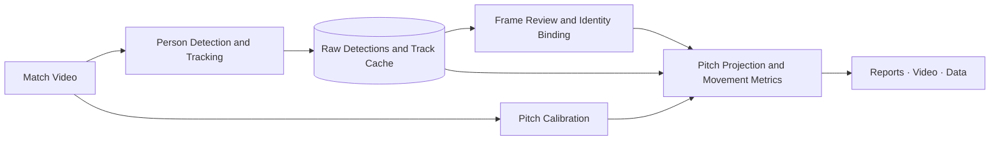

<div align="center">


### TouchLine：Turn match footage into player movement data you can verify.

A single-video player tracking and movement analysis workspace for youth academies, school teams, and amateur clubs.

[](pyproject.toml)
[](docs/architecture.md)
[](https://allwayso.github.io/Footballer-Analyzer-Demo/)

**[中文](README_zh.md)** · **[Live Demo](https://allwayso.github.io/Footballer-Analyzer-Demo/)** · **[Quick Start](#quick-start)** · **[User Guide](docs/getting-started.md)** · **[Documentation](docs/README.md)**

</div>

---

**Go beyond watching the match. See how every player moves.** TouchLine turns observations from ordinary match footage into pitch coordinates, individual trajectories, and movement reports. Review detections frame by frame, correct identities, and recalculate metrics from cached tracks. Every result can be checked against the original video.

- **No wearables required**: Start tracking players and analyzing movement with a match recording.
- **Runs on a CPU**: Run the analysis workflow on an ordinary computer, without a dedicated GPU.
- **No cloud upload**: Keep videos and analysis data on your own machine, from processing to review.
- **Accurate player tracking**: Combine motion and jersey color with frame-by-frame human review to improve identity continuity and accuracy.

## See It in Action

**[Open the interactive demo →](https://allwayso.github.io/Footballer-Analyzer-Demo/)** Explore the manually reviewed `barca_girona_25m00s` clip. No installation or sign-in required.

<p align="center">
  
</p>
<p align="center"><em>Replay trajectories, explore activity heatmaps, and see how each player's speed changes.</em></p>

| Video & Tracking | Manual Review | Movement Analysis |
|---|---|---|
| [View detection boxes, identities, and pitch projections](https://allwayso.github.io/Footballer-Analyzer-Demo/) | [Navigate frames, inspect segments, and review merge history](https://allwayso.github.io/Footballer-Analyzer-Demo/review.html) | [Replay trajectories, explore heatmaps, and compare movement](https://allwayso.github.io/Footballer-Analyzer-Demo/motion.html) |

The interactive demo uses precomputed results from 60.12 seconds of real match footage and supports viewing and exporting. Run the local workspace to detect players, calibrate the pitch, or edit identities. **Metrics cover this clip only. Accuracy in meters has not been independently validated.**

## Features

| Capability | What you can do |
|---|---|
| **Automatic tracking** | Detect people with YOLO and associate observations using motion and jersey color. Reuse cached detections to compare tracking settings; keep legacy ByteTrack for comparison. |
| **Linked video and pitch views** | Check boxes, foot points, and pitch positions in the same frame. Play, step through frames, jump to source frames, and select players across views. |
| **Two calibration workflows** | Use frame-by-frame white-line calibration for continuous 11-a-side tactical footage, or reference-point calibration for 8-a-side pitches and fixed cameras. |
| **Manual review and identity management** | Review segments, inspect reassociation suggestions, merge tracks, and undo automatic or manual changes. Use player profiles and frame-range bindings for persistent identities and exclusions. |
| **Individual movement reports** | Explore distance, speed curves, valid observation time, and activity heatmaps. Recalculate from cached tracks after changing calibration or identities. |
| **Independent ball tracking** | Run dedicated ball models and inspect candidates or missing frames separately from player tracking and calibration. Ball events and ball metrics are not part of movement reports. |
| **Traceable outputs** | Export HTML reports, annotated video, Parquet data, and input snapshots. Keep report versions and explicitly select which reports contribute to cross-clip statistics. |

## How It Works



Detection and reporting are separate stages: correcting identities or calibration does not require running detection again. Metrics use only consecutive valid observations; gaps are neither interpolated nor included in distance calculations. See [Architecture and Data Formats](docs/architecture.md) for module and file details.

## Quick Start

The commands below use Windows / PowerShell. Requires **Python 3.11+; 3.12 recommended**. Detection runs on the CPU by default and can optionally use an integrated GPU — see [GPU inference](docs/22-核显推理与设备切换.md).

### 1. Install

```powershell
git clone https://github.com/allwayso/TouchLine.git
cd TouchLine
python -m venv .venv
& .\.venv\Scripts\python.exe -m pip install --upgrade pip
& .\.venv\Scripts\python.exe -m pip install torch torchvision --index-url https://download.pytorch.org/whl/cpu
& .\.venv\Scripts\python.exe -m pip install -e . -c configs/constraints-tested.txt
```

### 2. Prepare a Video and Model

```powershell
New-Item -ItemType Directory -Force data/clips, models | Out-Null
```

Place a **constant-frame-rate video** you have permission to use in `data/clips/`. Save the [Ultralytics YOLOv8n detection weights](https://docs.ultralytics.com/models/yolov8/#supported-tasks-and-modes) as `models/yolov8n.pt`. Analysis footage and model weights are not included in the repository.

### 3. Launch the Workspace

```powershell
& .\.venv\Scripts\python.exe -m footballer_analyzer serve --port 8766
```

Open **[http://127.0.0.1:8766/](http://127.0.0.1:8766/)** and select a video:

**Choose video → Track players → Confirm pitch calibration → Review and bind identities → Generate movement reports.**

See the [User Guide](docs/getting-started.md) for detailed workflows, CLI commands, parameters, and troubleshooting. If your environment is already set up, launch the workspace directly.

## Documentation

Supporting documentation is currently in Chinese.

| I want to… | Start here |
|---|---|
| Install, analyze my first video, or adjust parameters | [User Guide](docs/getting-started.md) |
| Understand the pipeline, outputs, and identity conventions | [Architecture and Data Formats](docs/architecture.md) |
| Review measured results and accuracy limits | [Validation and Known Limitations](docs/validation.md) |
| Contribute code or report an issue | [Contributing Guide](CONTRIBUTING.md) |
| Explore algorithm choices, commercial solutions, and research | [Full Documentation Index](docs/README.md) |

## Project Status

The project provides a complete local workflow for detection, pitch calibration, manual identity correction, and versioned reports, alongside a public interactive demo. Current work focuses on validating tracking stability and distance accuracy on real footage.

- **Suitable footage**: Fixed-camera recordings or continuous tactical views with clear pitch markings. Camera conditions affect detection and projection quality.
- **Result limitations**: Missed detections, fragmented tracks, and ID switches can still occur. Manual review corrects identities; it does not recognize players' real names. Full-match stability and distance error in meters have not been independently validated.
- **Current scope**: Player movement analysis and independent ball detection/tracking review. The public demo shows player results. Possession and passing events, multi-camera fusion, and a public real-time service are not yet available.

Measured results are recorded by clip and configuration in the [Validation Documentation](docs/validation.md). Short-clip results are not treated as evidence of full-match performance.

## Contributing

Issues with source frame numbers, configurations, and reproduction steps are welcome, as are improvements to tracking, calibration, and review. See [CONTRIBUTING.md](CONTRIBUTING.md) for development conventions and checks.

## Licensing and Acknowledgments

Thanks to open-source projects including [Ultralytics](https://github.com/ultralytics/ultralytics), [Supervision](https://github.com/roboflow/supervision), and [OpenCV](https://github.com/opencv/opencv).

This repository does not currently declare a project-wide open-source license. The Ultralytics detection dependency is subject to AGPL-3.0 / commercial licensing; check the applicable terms before use or distribution. Model weights, match footage, and third-party reference source code are not distributed with the repository. See [Third-Party Repositories and Licenses](docs/01-参考仓库清单与许可.md).
