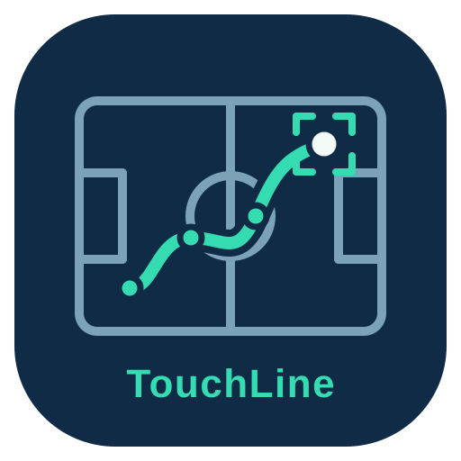
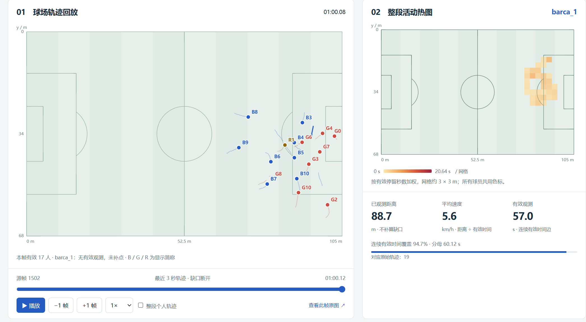
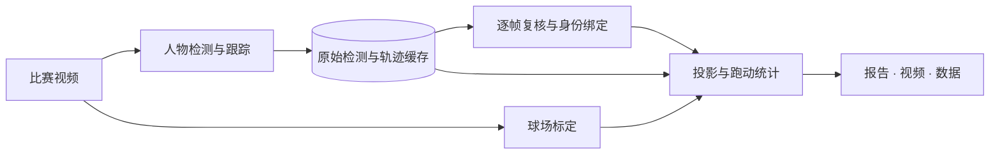

<div align="center">



### TouchLine：让比赛录像，成为可复核的球员跑动数据

面向青训、校园足球与业余球队的 **免费** 单视频球员追踪与跑动分析工作台。

[](pyproject.toml)
[](docs/architecture.md)
[](https://allwayso.github.io/Footballer-Analyzer-Demo/)

**[English](README.md) · [在线演示](https://allwayso.github.io/Footballer-Analyzer-Demo/) · [快速开始](#快速开始) · [使用指南](docs/getting-started.md) · [文档中心](docs/README.md)**

</div>

---

**从“看过比赛”，到“看清每个人怎么跑”。** TouchLine 将普通比赛视频中的人物观测，转化为球场坐标、个人轨迹与跑动报告。自动检测后可以逐帧复核、校正身份，再使用缓存重算统计，让结果能回到原视频中核对。

- **无需穿戴式设备**：一段比赛录像，即可开展球员追踪与跑动分析。
- **CPU 即可计算**：无需独立显卡，普通电脑也能运行分析流程。
- **无需上云**：视频与分析数据保留在本机，本地完成处理与复盘。
- **高精度识别**：运动与球衣颜色联合追踪，结合逐帧人工复核，提升球员身份的连续性与准确性。

## 先看效果

**[打开交互演示 →](https://allwayso.github.io/Footballer-Analyzer-Demo/)** 无需安装或登录，即可查看已人工校验的 `barca_girona_25m00s` 片段。

<p align="center">
  
</p>
<p align="center"><em>球场轨迹回放、活动热图与速度变化，直观看清每个人怎么跑。</em></p>

| 视频与识别结果 | 人工校验记录 | 跑动分析 |
|---|---|---|
| [查看检测框、身份与球场投影](https://allwayso.github.io/Footballer-Analyzer-Demo/) | [逐帧定位，查看片段与融合历史](https://allwayso.github.io/Footballer-Analyzer-Demo/review.html) | [轨迹回放、活动热图与跑动对比](https://allwayso.github.io/Footballer-Analyzer-Demo/motion.html) |

交互演示站使用 60.12 秒真实视频的预计算结果，只提供浏览与导出；在线检测、标定和修改身份请运行本地工作台。**仅统计本片段，米制精度尚未独立验证。**

## 核心能力

| 能力 | 你可以做什么 |
|---|---|
| **自动追踪** | YOLO 人物检测，运动与球衣颜色联合跨帧关联；可复用检测缓存重跟踪，保留原版 ByteTrack 供对照。 |
| **原图与球场联动** | 同帧核对检测框、脚点和球场位置，支持播放、逐帧、源帧跳转及点选联动。 |
| **两类场地标定** | 十一人制连续战术镜头逐帧白线标定；八人制与固定镜头使用参考点配对标定。 |
| **人工复核与身份管理** | 独立页面核对片段、重关联推荐、融合与撤销，区分自动／手动操作；通过球员档案和区间绑定处理持久身份及排除。 |
| **个人跑动报告** | 距离、速度曲线、有效时间与活动热图；修改标定或身份后复用轨迹缓存重算。 |
| **独立足球追踪** | 单独运行球检测模型，复核候选和缺失帧，无需重跑人物与标定；跑动报告尚不包含足球事件和球数据指标。 |
| **可追溯的分析产物** | HTML 报告、叠加视频、Parquet 数据及输入快照；保留历史版本，显式选择跨片段统计来源。 |

## 工作原理



检测与报告分开计算：纠正身份或标定后无需重新检测。统计只使用连续有效观测，缺口不插值、不补算距离。模块和文件格式见 [架构与数据说明](docs/architecture.md)。

## 快速开始

以下为 Windows / PowerShell 的本地启动方式。要求 **Python 3.11+，推荐 3.12**；检测默认使用 CPU，可选用 GPU 推理，见 [GPU 推理与设备切换](docs/22-GPU推理与设备切换.md)。

### 1. 安装

```powershell
git clone https://github.com/allwayso/TouchLine.git
cd TouchLine
python -m venv .venv
& .\.venv\Scripts\python.exe -m pip install --upgrade pip
& .\.venv\Scripts\python.exe -m pip install torch torchvision --index-url https://download.pytorch.org/whl/cpu
& .\.venv\Scripts\python.exe -m pip install -e . -c configs/constraints-tested.txt
```

若要在 NVIDIA 显卡上运行检测，把上面的 CPU 版 PyTorch 换成 CUDA 版即可（只需 NVIDIA 驱动，wheel 自带 CUDA 运行时）：

```powershell
& .\.venv\Scripts\python.exe -m pip install torch torchvision --index-url https://download.pytorch.org/whl/cu130
```

随后在配置里设 `device: gpu`、命令行加 `--device gpu`，或在前端下拉框选择即可。

### 2. 准备视频与模型

```powershell
New-Item -ItemType Directory -Force data/clips, models | Out-Null
```

将有权使用的**恒定帧率视频**放入 `data/clips/`，将 [Ultralytics YOLOv8n 检测权重](https://docs.ultralytics.com/models/yolov8/#supported-tasks-and-modes)保存为 `models/yolov8n.pt`。视频和模型不随仓库分发。

### 3. 启动工作台

```powershell
& .\.venv\Scripts\python.exe -m footballer_analyzer serve --port 8766
```

打开 **[http://127.0.0.1:8766/](http://127.0.0.1:8766/)**，选择素材开始分析：

**选择视频 → 自动追踪 → 确认场地标定 → 复核并绑定身份 → 生成跑动报告。**

完整操作、CLI、参数和常见问题见 [使用指南](docs/getting-started.md)。已有环境可直接启动，无需重复安装。

## 文档

| 我想…… | 从这里开始 |
|---|---|
| 安装、分析第一段视频、调整参数 | [使用指南](docs/getting-started.md) |
| 理解流水线、产物和身份口径 | [架构与数据说明](docs/architecture.md) |
| 了解实测证据与精度边界 | [验证与已知限制](docs/validation.md) |
| 修改代码或提交问题 | [开发与贡献指南](CONTRIBUTING.md) |
| 查阅算法选型、商业方案和专题研究 | [完整文档索引](docs/README.md) |

## 项目状态

已具备本地检测、场地标定、人工身份校正和版本化报告的完整工作流，并提供公开交互演示。当前重点是验证真实素材上的跟踪稳定性与距离精度。

- **适用输入**：固定机位或白线清晰的连续战术视角视频；镜头条件影响检测与投影质量。
- **结果边界**：仍可能漏检、断轨或换 ID；人工确认用于校正身份，不等于识别真实姓名。完整比赛稳定性和米制距离误差尚未独立验收。
- **当前范围**：球员跑动分析与独立足球检测／追踪复核，公开演示展示球员结果；控球／传球事件、多摄融合及对外实时服务尚未提供。

实测数字按素材与配置记录在 [验证文档](docs/validation.md)，不将短片结果外推为整场能力。

## 参与开发

欢迎提交带源帧、配置和复现步骤的问题，或改进跟踪、标定与复核体验。开发约定和检查命令见 [CONTRIBUTING.md](CONTRIBUTING.md)。

## 许可与致谢

感谢 [Ultralytics](https://github.com/ultralytics/ultralytics)、[Supervision](https://github.com/roboflow/supervision) 和 [OpenCV](https://github.com/opencv/opencv) 等开源项目。

本仓库目前未声明项目整体的开源许可证。检测依赖 Ultralytics 涉及 AGPL-3.0／商业许可；使用与分发前请核对适用条款。模型、比赛视频及第三方参考源码不随本仓库分发。详见 [第三方仓库与许可](docs/01-参考仓库清单与许可.md)。
