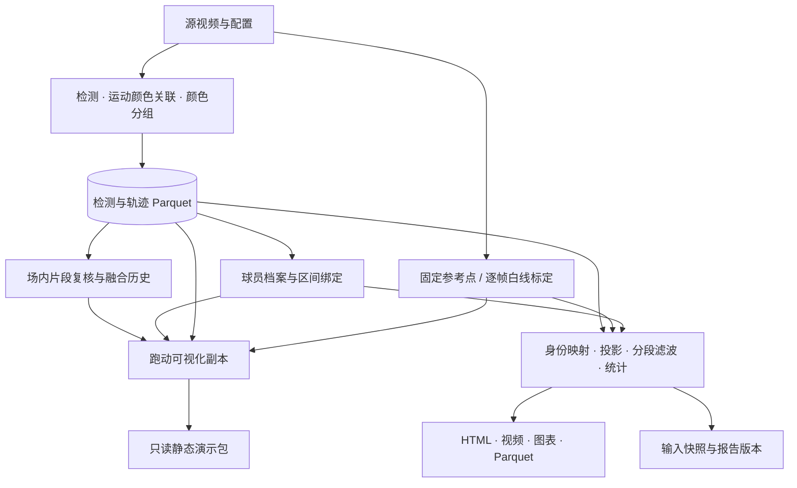

# 架构与数据说明

[项目首页](../README.md) · [使用指南](getting-started.md) · [文档索引](README.md)

项目以本地文件为计算边界，采用“检测跟踪缓存 + 可重算报告”两阶段流程。浏览器工作台与 CLI 复用同一套 Python 模块。

## 数据流



常规报告使用区间绑定，不自动同步场内融合。独立跑动可视化会在副本中采用仍生效且身份无冲突的融合组；显式绑定与排除优先，不改写原始轨迹或绑定。静态演示使用同一可视化快照。详见 [20 跑动可视化](20-球员跑动可视化.md) 和 [21 静态演示站](21-评委静态演示站.md)。足球追踪为独立分支，不参与当前跑动指标。

## 模块职责

| 模块 | 职责 |
|---|---|
| `cli.py` / `config.py` | 命令解析、配置校验与默认值。 |
| `video.py` / `detection.py` / `tracking.py` | 源帧读取、YOLO 人物检测、跟踪接口与原版 ByteTrack 适配。 |
| `motion_tracking.py` / `retracking.py` | 运动颜色在线关联、延迟确认与检测缓存重跟踪。 |
| `pipeline.py` / `teams.py` | 跟踪编排、球衣颜色分组、原始缓存和预览写出。 |
| `field_review.py` / `reassociation.py` / `stream_association.py` | 场内片段、后置关联证据、融合历史与撤销。 |
| `ball_detection.py` / `ball_tracking.py` / `ball_pipeline.py` | 独立足球模型、跨帧筛选与结果版本。 |
| `pitch_models.py` / `pitch_geometry.py` | 十一人制与八人制模型、参考点和场地几何。 |
| `calibration.py` / `dynamic_calibration.py` / `white_line_pipeline.py` | 固定投影、运动镜头白线匹配与独立标定运行。 |
| `identity.py` / `metrics.py` / `reporting.py` | 身份区间、有效观测切段、跑动统计与版本化报告。 |
| `motion_visualization.py` / `static_demo.py` | 轨迹回放、热图、跑动对比与静态站导出。 |
| `benchmark.py` / `performance.py` | 阶段性能基准与耗时记录。 |
| `server.py` / `web/` | 本地 HTTP API、人工复核与原生 HTML/CSS/JavaScript 前端。 |
| `storage.py` | Parquet、YAML、JSON、摘要与运行编号。 |

完整设计与接口约束见 [07 架构设计与最小闭环](07-架构设计与最小闭环.md)。编号文档保留当时的设计和验收背景，当前操作以 [使用指南](getting-started.md) 为准。

## 目录与产物

```text
configs/                         配置、验收参考点与依赖版本约束
src/footballer_analyzer/          Python 应用与包内 web/ 前端
tests/                           算法、文件、时间与 HTTP 边界测试
scripts/                         素材体检、复查与调研基准脚本
docs/                            使用文档、设计、研究与验收记录
outputs/run_*/
  manifest.json                  输入摘要、帧率、配置、依赖、状态与耗时
  detections.parquet             关联前检测框与分数，包含未关联框
  tracks.parquet / tracks.mp4     原始真实观测与轨迹预览
  catalog.json / crops/           轨迹目录与缩略图
  track_catalog.html             本地缩略图索引
  calibration.yaml               标定、适用范围与确认状态
  calibrations/lines_*/           逐帧标定版本、frames.json 与白线证据
  balls/ball_*/                   独立足球结果与模型指纹，漏检保留为空
  bindings.yaml                  本运行的身份与排除区间
  field_review.json              场内片段融合及撤销历史
  diagnostics/                   复查脚本输出的图像与 JSON
  reports/report_*/              报告、视频、图表、统计与输入快照
  reports/report_viz_*/          独立可视化、有效融合副本与输入快照
data/players.yaml                持久球员档案
```

`data/`、`models/`、`outputs/`、虚拟环境与第三方参考源码均不纳入 Git。公共静态演示使用独立的 [Footballer-Analyzer-Demo 仓库](https://github.com/allwayso/Footballer-Analyzer-Demo)，不依赖本地服务在线。

## 数据口径

- **身份**：`track_id` 只在单次运行内有效；`player_id` 是人工维护的持久档案，不代表自动识别真实姓名。
- **队伍**：颜色聚类是候选，`home/away` 由人工确认。相同球衣颜色不能证明相同身份。
- **时间**：帧号来自源视频；区间采用 `[start_frame, end_frame)`，采样不改变源时间。
- **坐标**：检测框与脚点使用像素；经有效标定投影后使用米。标定状态和适用范围参与统计门禁。
- **缺口**：按有效观测、身份和标定边界切段，不跨缺口补点或计距。跟踪器的丢失缓冲不产生真实观测。
- **重算**：修正身份或标定后只重算报告，保留原始轨迹及旧报告。历史统计显式选版本，避免同一片段重复累计。

跟踪缓存流式写出；报告与浏览器接口会载入所选运行的数据。当前没有据此宣称已验证整场规模的内存和性能。
